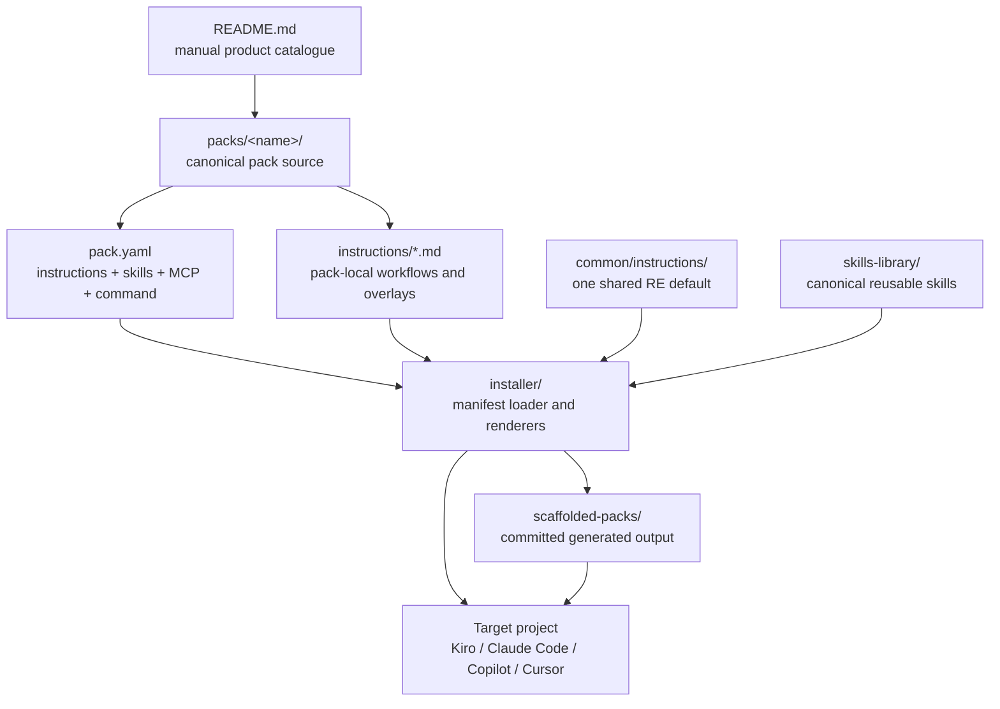

# Current Repository Assessment

## Executive finding

The repository has a sound technical kernel but an unclear product model.
The September 2026 restructure established useful single sources of truth for
skills, one shared reverse-engineering instruction, and a renderer that targets
four agent tools. However, the repository still presents unlike things as peer
“packs”: modernization motions, workload archetypes, SDLC automations,
operational agents, and a generic workflow base. Users must understand the
repository’s implementation history before they can choose the right asset.

The main structural problem is therefore not the number of folders. It is the
absence of explicit layers and metadata:

1. RAMP program/lifecycle assets;
2. the AI-DLC workflow foundation;
3. modernization use-case blueprints;
4. workload/runtime patterns;
5. cross-cutting engineering capabilities;
6. tool adapters and distribution outputs.

These layers currently collapse into `packs/`, long duplicated workflow files,
and manually curated README tables.

## Evidence and repository scale

- The Git index contains 969 tracked files.
- `packs/` contains 373 tracked files. Of these, 264 are generated files under
  `scaffolded-packs/`; 109 are canonical pack sources and supporting files.
- `skills-library/` contains 562 tracked files and approximately 5.8 MB. It is
  the largest canonical content area and is referenced by name from manifests.
- Fourteen directories contain `pack.yaml` and are discoverable by the
  installer.
- A fifteenth committed pack, `regression-software-testing`, is a
  steering-only exception with no manifest and is invisible to the installer.
- A local empty directory, `packs/outsystems-exit-on-serverless`, is not a
  tracked repository asset but adds workspace ambiguity.
- The installer test baseline passes: 10 test files and 60 tests on
  2026-11-04.

## Current-state map

### Source-of-truth ownership

| Area | Role | Canonical or derivative | Observations |
|---|---|---:|---|
| `packs/*/pack.yaml` | Pack composition | Canonical | Manifest schema is intentionally small but cannot describe catalogue dimensions, provenance, maturity, RAMP phase, ownership, or compatibility. |
| `packs/*/instructions/` | Pack behavior | Canonical | Every manifest pack owns a full primary workflow; common behavior is copied into many files. |
| `common/instructions/reverse-engineering.md` | Shared default | Canonical | The only shared instruction module. Five packs override it locally. |
| `skills-library/` | Reusable expertise | Canonical | Strongest existing separation of cross-cutting capabilities from use cases. No machine-readable provenance/version metadata is visible at catalogue level. |
| `packs/*/skills/` | Per-pack skill shadow | Canonical override | Supported by the renderer, but no current pack-local shadow directories were found in the top-level inventory. |
| `installer/` | Composition/rendering engine | Canonical code | Load, plan, render, and copy pipeline; supports four hard-coded tools. |
| `packs/*/scaffolded-packs/` | No-Node distribution | Generated/committed | Useful for consumers but dominates pack navigation and review volume. |
| `packs/*/add-skills.sh` | No-Node skill installer | Generated/committed | Regenerated from manifests and checked by CI. |
| `packs/*/add-skills.ps1` | Windows skill installer | Committed parallel implementation | Not emitted by `build-all` and not included in the stale-output CI check. Current Bash/PowerShell skill lists match, but future drift is not prevented. |
| `README.md` and pack READMEs | Discovery and usage | Manually maintained | Catalogue and section structures can drift from manifests. |

## Load-bearing components

1. `installer/src/manifest.js` defines the effective pack schema. It validates
   only that there is exactly one primary instruction.
2. `installer/src/render/instructions.js` resolves local-versus-common
   instructions and maps them to tool-specific locations.
3. `installer/src/skills.js` implements the valuable
   pack-local-shadow → shared-library resolution rule.
4. `installer/src/render/mcp.js` translates the loosely normalized MCP entries
   across the four tools.
5. `installer/src/build-all.js` discovers every direct child of `packs/` with a
   manifest and rebuilds committed outputs.
6. `.github/workflows/build-packs.yml` protects the JavaScript renderer,
   committed scaffolds, and Bash skill installers from drift.
7. Each pack’s `instructions/aidlc-workflow.md` is load-bearing at runtime,
   despite the high level of repeated lifecycle logic across packs.
8. `common/instructions/reverse-engineering.md` is the first successful
   instruction-level composition seam and a useful precedent for the revamp.

## The catalogue mixes four different classification axes

### A. Modernization motions

- `legacy-transformation-on-aws`
- `cots-rewrite-on-cloudnative`
- `framework-upgrade-containerise`
- `dotnet-app-modernization-on-aws`
- `api-platform-migration-n-modernization`

These answer “what transformation is being performed?”

### B. Solution and workload archetypes

- `web-app-on-cloudnative`
- `serverless-event-driven-on-aws`
- `genai-on-serverless`
- `ocr-mobile-app-on-serverless`
- `voice-ai-agent-on-aws`

These answer “what type of system is being built?”

### C. SDLC and operations automations

- `qa-automated-testing`
- `regression-software-testing`
- `vulnerability-remediation-pipeline`
- `agentic-incident-response`

These answer “which lifecycle activity is being automated or augmented?”

### D. Generic foundation

- `agentic-ai-workflow`

This is closer to a base workflow/distribution profile than a customer use
case, yet it is presented as a peer product.

The axes are independently useful, but a single folder hierarchy cannot
represent all of them without ambiguity. They should become manifest facets
and composable layers rather than competing naming conventions.

## Concrete consistency and maintainability findings

### 1. The AI-DLC lifecycle is forked across fourteen primary files

Every manifest pack has its own `instructions/aidlc-workflow.md`, ranging from
426 to 591 lines. Several share most exact non-blank lines with
`agentic-incident-response`; others have diverged into specialized workflows.
This makes a global lifecycle improvement a fourteen-way reconciliation
exercise and obscures which differences are intentional.

The shared reverse-engineering default proves that composition works, but the
foundation has not been extended to state management, audit logging, approval
gates, requirements, design, tasks, construction, verification, and closure.

### 2. The manifest describes rendering, not a blueprint product

The supported properties are effectively:

- `name`, `title`, `description`;
- instruction files with `role`, `load`, and optional description;
- command;
- MCP definitions;
- skill names.

It cannot answer basic catalogue questions such as:

- Which RAMP phase or customer entry point does this serve?
- Is this Transform, Reimagine, Agentize, or an SDLC accelerator?
- Is it an application blueprint, capability overlay, workload pattern,
  delivery profile, or reference example?
- Which languages, source platforms, target runtimes, and input evidence are
  supported?
- Is it experimental, field-tested, certified for partner delivery, or
  deprecated?
- Which upstream AI-DLC version is it compatible with?
- Who owns it, when was it last validated, and what customer evidence was
  generalized into it?

### 3. Generated content is intentionally shipped but visually overwhelms source

`scaffolded-packs/` is a legitimate offline/no-Node distribution mechanism, not
accidental duplication. Nevertheless, 264 generated files live inside the same
folders people browse to understand and author packs. Reviewers see tool
renderings beside canonical sources, and repository search returns the same
instruction in multiple formats. The source/distribution boundary is technical
rather than obvious.

### 4. Two installation paths create a parity surface

Consumers can either:

- run `ramp-pack init`, which copies skills and renders steering; or
- copy a committed tool scaffold, then run a separate skill installer.

This is useful accessibility, but it creates more parity obligations. CI checks
generated tool scaffolds and Bash installers. It does not regenerate or compare
the PowerShell installers, so Windows parity relies on convention.

### 5. Conditional-loading semantics are not uniform

Kiro receives `inclusion: auto`; Copilot receives conditional instruction
descriptions; Cursor companions receive `alwaysApply: false`. Claude Code’s
generated `CLAUDE.md` states that all companion rule files “load automatically
and MUST be followed,” even for manifest entries marked `load: auto`. This may
turn optional brownfield or traceability overlays into effectively global
instructions on that tool.

### 6. Default command text can understate specialized workflows

Only some manifests define a custom command body. The default renderer prompt
says to detect greenfield/brownfield and run Requirements → Design → Tasks.
That is a weaker and sometimes differently shaped entry point than specialized
workflows such as Java upgrade/containerization, targeted reverse engineering,
multi-repo contract splitting, or document-driven COTS reconstruction.

### 7. Catalogue drift is already visible

The root starter-pack table does not list three installer-discoverable packs:

- `dotnet-app-modernization-on-aws`;
- `framework-upgrade-containerise`;
- `serverless-event-driven-on-aws`.

It does list `regression-software-testing`, which the installer cannot discover.
Pack README structures also vary significantly, so comparison requires reading
each document end-to-end.

### 8. Validation emphasizes rendering, not blueprint quality

The passing test suite provides good confidence in file placement, rendering,
skill copying, and selected legacy-transformation contracts. It does not
systematically validate every pack for:

- required catalogue metadata and schema version;
- lifecycle conformance or intentional deviations;
- instruction conflicts and token size;
- live tool/MCP compatibility;
- licensing and upstream provenance;
- stale service guidance;
- phase deliverables and RAMP outcomes;
- end-to-end behavior in each supported agent.

### 9. Naming encodes history rather than a controlled vocabulary

Examples include `modernization` and `modernisation`, `cloudnative` and
`cloud-native`, `containerise`, the abbreviation `n`, service-specific names,
outcome-specific names, and implementation-specific names. The names are
understandable individually but do not form a predictable catalogue grammar.

## How strongly the repository expresses RAMP today

### Present

- The root README explicitly positions the packs as part of RAMP.
- It explains Transform from Legacy and Reimagine and Build.
- The pack mechanism supports reusable steering, skills, MCP, state, audit,
  decisions, and repeatable delivery across four tools.
- Several packs encode field-learned modernization patterns, including
  document-led COTS reconstruction, targeted reverse engineering, multi-repo
  contract management, framework upgrades, testing, vulnerability remediation,
  and incident response.

### Missing or difficult to discover

- RAMP’s lifecycle is not the repository’s primary navigation model.
- There is no explicit transition from proof-of-value to production, executive
  readout, portfolio/wave planning, or org-wide scale.
- There are no first-class program assets for workload qualification, outcome
  measurement, ROI, executive readout, wave-plan generation, champion/partner
  enablement, or change management.
- Platform engineering, golden IaC/runtime patterns, governance, observability,
  security, FinOps, and Day-2 operations appear as skills inside selected packs
  rather than as discoverable cross-cutting capability overlays.
- The repository cannot distinguish a field-tested reusable blueprint from a
  sample, experiment, base profile, or narrow accelerator.
- There is no “choose/combine a blueprint” experience based on modernization
  intent, evidence available, workload shape, target architecture, RAMP phase,
  and lifecycle capabilities.

The current repository therefore embodies an AI-DLC workshop asset library more
strongly than it embodies the full RAMP modernization-at-scale program.

## Likely colleague/customer-derived attempts

No committed file identifies a customer, which is consistent with the README’s
stated anonymization policy. A definite customer-to-pack mapping cannot be
recovered from the repository alone.

Git history does identify several colleague-authored candidates:

| Candidate | Evidence | Confidence about colleague authorship | Confidence it is the customer attempt mentioned |
|---|---|---:|---:|
| `framework-upgrade-containerise` | Initially authored by Adi and merged in PR #14; contains a highly prescriptive Stage 0, Java upgrade/containerization path, and an explicit customer-profile overlay concept. | High | Medium |
| `agentic-incident-response` | Initially authored by Adi and merged in PR #16; later retained as a specialized SDLC/operations pack. | High | Low–medium |
| `vulnerability-remediation-pipeline` | Baseline authored by Adi on its feature branch, then substantially refined by the repository owner. | High | Low–medium |
| `cots-rewrite-on-cloudnative` | Evolved from `enterprise-app-on-cloudnative` into a document/FSD/OutSystems-driven reconstruction workflow, which strongly resembles generalization from an engagement. | High that it is engagement-derived; author is the repository owner | Low for “colleague” |

The most plausible colleague-authored workflow to inspect first is
`framework-upgrade-containerise`, but this is an inference, not proof. The
owner should identify the intended customer attempt before its design is used as
the AI-DLC v2 reference.

## Risk register

| Risk | Evidence | Consequence | Severity |
|---|---|---|---:|
| Workflow-fork drift | Fourteen 426–591-line primary workflow files | Fixes and upstream changes propagate inconsistently | High |
| Category ambiguity | Transformation, workload, SDLC, operations, and base packs are peers | Users choose by folder name and may select or duplicate the wrong asset | High |
| RAMP scope compression | Catalogue centers on starter packs for the workshop | Production, executive, portfolio, platform, and change outcomes remain outside the repository | High |
| Weak product metadata | Minimal `pack.yaml` schema | No generated catalogue, compatibility policy, maturity, ownership, or lifecycle discovery | High |
| Upstream divergence | “Adapted from” attribution without machine-readable upstream baseline | AI-DLC improvements require manual comparison and may be copied inconsistently | High |
| Source/generated discoverability | 264 generated files colocated with canonical sources | Search noise, large reviews, accidental editing of derivatives | Medium |
| Windows installer drift | PowerShell scripts not generated or CI-compared | Pack skill sets can silently diverge by OS | Medium |
| Cross-tool semantic drift | Conditional instructions render differently by tool | Same pack may behave differently across agents | High |
| Generic command mismatch | Default kickoff body ignores specialized stage shapes | User enters a narrower generic workflow than the pack promises | Medium |
| Catalogue drift | README table and installer discovery disagree | Assets are hidden or appear supported when they are not installable | Medium |
| Quality certification gap | Tests focus on renderer plus selected contracts | A pack can render successfully while being stale or behaviorally conflicting | High |
| Skill provenance/staleness | Large vendored library with no central machine-readable version/owner policy | Security, service, licensing, and compatibility updates are difficult to govern | Medium–high |

## Structural implications for the revamp

These are constraints and opportunities derived from the evidence, not a final
target design:

1. Preserve the renderer and skill-library resolution model; they are useful
   foundations.
2. Make the AI-DLC lifecycle a versioned core composed by packs, not copied into
   every use case.
3. Treat modernization use cases, workload patterns, and SDLC/Day-2
   capabilities as separate composable asset types.
4. Use a faceted catalogue generated from manifests. Do not force every
   dimension into folder names.
5. Give RAMP phases and outcomes first-class metadata and assets, including the
   handoffs beyond the MVP workshop.
6. Keep generated distributions, but move or publish them behind an obvious
   build boundary and verify every supported distribution path.
7. Add maturity, owner, evidence/provenance, compatibility, and validation
   fields before adding more packs.
8. Model customer-specific data as private engagement overlays that compose
   approved public assets; do not fork public blueprint content per customer.

## Questions the repository cannot answer

1. Which exact folder or branch is the colleague’s customer-specific AI-DLC v2
   attempt?
2. Which assets are production-proven, workshop-proven, experimental, or only
   illustrative?
3. Is the primary consumer an AWS specialist, an enabled partner, a customer
   platform team, or all three with different distributions?
4. Must committed per-tool scaffolds remain in the main branch, or can releases
   carry generated artifacts?
5. Which AI-DLC upstream version/commit should define the compatibility
   baseline?
6. Which RAMP phases should this repository execute directly, and which should
   it only support through templates and handoff artifacts?
7. What governance is required before a customer-derived pattern is promoted
   into the public catalogue?
